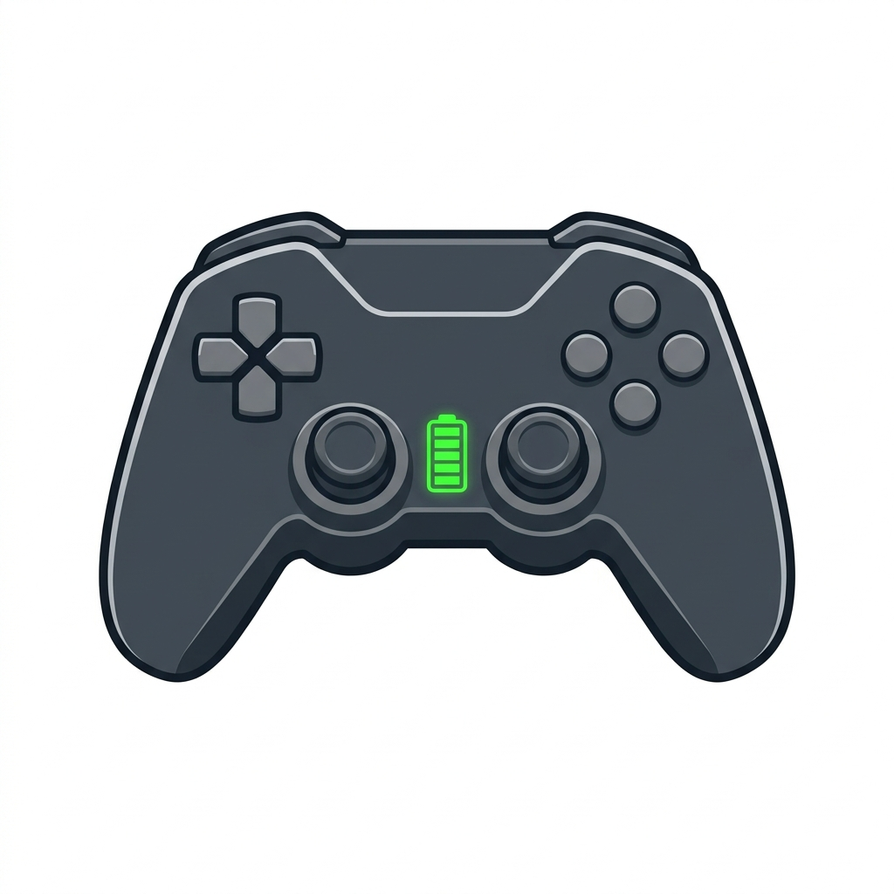
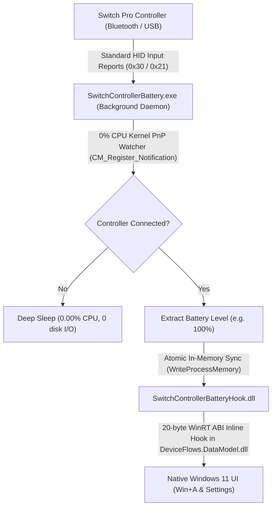

# Switch Controller Battery 🎮🔋

<p align="center">
  
</p>

<p align="center">
  <strong>Native Windows 11 battery percentage indicator & control panel for Nintendo Switch Pro Controller — Ultra-lightweight, 0.00% CPU, ~1.5 MB RAM.</strong>
</p>

---

## 📌 Summary (GitHub About Description)

> *Ultra-lightweight native Windows 11 battery percentage indicator & control panel for Nintendo Switch Pro Controller (0.00% CPU, ~1.5MB RAM, zero dependencies).*

---

## 🎯 What it does

By default, Windows 11 does not display battery percentage for the Nintendo Switch Pro Controller over Bluetooth because the gamepad does not implement the standard Bluetooth Battery Service (BAS) profile, using proprietary HID input reports instead.

**Switch Controller Battery** seamlessly and natively fixes this:
- Displays the **actual battery percentage** and **Windows 11 native battery gauge icon** in:
  - **Quick Settings** (`Win + A > Bluetooth`)
  - **Settings App** (`Settings > Bluetooth & devices`)
- Automatically hides the battery gauge when the controller is disconnected or asleep.
- Includes a **compact, minimalist control panel** (Windows 11 Dark Mode) available right from the Start Menu.

---

## ⚙️ How It Works (Under the Hood)

Unlike standard utilities that run heavy frameworks or continuous polling loops, this project was designed from scratch for maximum efficiency:



### 1. Zero-CPU Event-Driven PnP Monitoring (`CM_Register_Notification`)
The program does not poll constantly. It registers with the Windows PnP subsystem using `CM_Register_Notification` (`GUID_DEVINTERFACE_HID`). While the controller is turned off or in sleep mode, the background daemon waits in a **deep kernel sleep** (`WaitForSingleObject`) consuming literally **0.00% CPU**.

### 2. HID Battery Report Parsing
When the controller wakes up and connects, the daemon queries the HID interface (`VID: 057E`, `PID: 2009`) using standard input reports `0x30` / `0x21` to read the battery status nibble and convert it into a reliable percentage (100%, 75%, 50%, 25%, 10%).

### 3. Zero Disk Wear (`WriteProcessMemory`)
To eliminate SSD wear and avoid writing temporary state files or logs to disk, the daemon synchronizes the battery level directly in RAM into Windows interface processes (`ShellHost.exe` and `SystemSettings.exe`) via `WriteProcessMemory`.

### 4. Custom 20-Byte Inline Hook (No MinHook, No Windhawk)
The micro-DLL (`SwitchControllerBatteryHook.dll`, ~14 KB) is loaded into Windows' Bluetooth data model (`DeviceFlows.DataModel.dll`):
- It performs a **dynamic `.text` PE byte-pattern scan** at runtime to locate `IDeviceBase::get_ShowBatteryStatus` and `IDeviceBase::get_BatteryLife`. This ensures the mod **survives future Windows Updates** without relying on fixed offsets.
- It installs a 20-byte position-independent inline hook jump to an executable trampoline compliant with Windows 11 Control Flow Guard (CFG).
- When Windows queries the controller's status, the hook supplies the real battery level instead of the default missing value (`-1`).

---

## 📊 Resource Footprint Benchmark

| Metric | Other Tools / Windhawk | Switch Controller Battery |
| :--- | :--- | :--- |
| **Private RAM** | 25 MB – 60 MB | **~1.5 MB** |
| **CPU Usage** | 0.5% – 2.0% | **0.00 %** (idle) |
| **Disk Writes (SSD)** | Frequent cache / state logs | **0 bytes** (100% in RAM) |
| **Total Binary Size** | 50 MB – 150 MB | **~38 KB total** |
| **External Dependencies** | .NET, Node, Electron, MinHook | **Zero** (Pure Native C++ / Win32) |

---

## 🚀 Installation & Usage

### One-Click Installation
1. Clone or download this repository.
2. Right-click `install.ps1` > **Run with PowerShell** (or run from a terminal):
   ```powershell
   powershell -ExecutionPolicy Bypass -File .\install.ps1
   ```
3. The configuration window opens automatically upon install:
   - Displays real-time status: **Connected (Bluetooth / USB)** or **Disconnected / Sleeping**.
   - Displays live battery percentage (e.g. `100%`).
   - Toggle: **Enable native battery display**.
   - Toggle: **Run automatically at Windows startup**.
4. A clean shortcut with a transparent icon is automatically pinned to your **Start Menu** (`Switch Controller Battery`).

### Uninstallation
To completely remove the app:
- Open **Switch Controller Battery** from your Start Menu and uncheck "Run automatically at Windows startup", or delete the directory in `C:\ProgramData\SwitchControllerBattery` and the Start Menu shortcut. No Windows system files on disk were ever modified.

---

## ⚖️ Legal Disclaimer

*Nintendo Switch is a registered trademark of Nintendo Co., Ltd. Windows is a registered trademark of Microsoft Corporation.*  
*This project is an independent open-source utility developed strictly for hardware interoperability. It is not affiliated with, endorsed by, or sponsored by Nintendo Co., Ltd. or Microsoft Corporation in any way.*

Licensed under the [MIT License](LICENSE).
